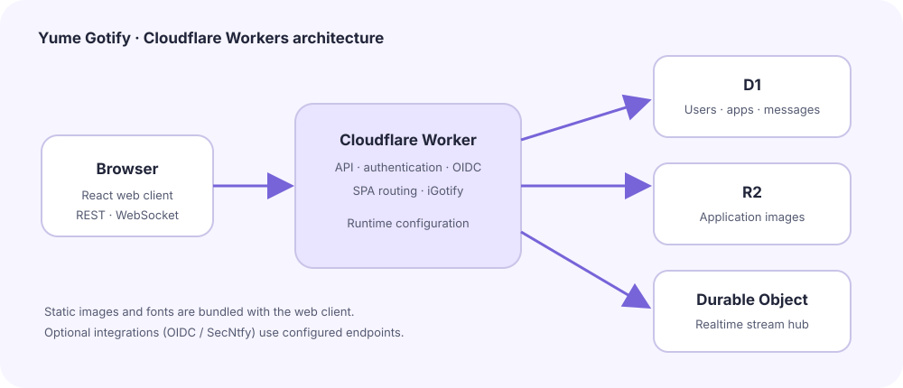
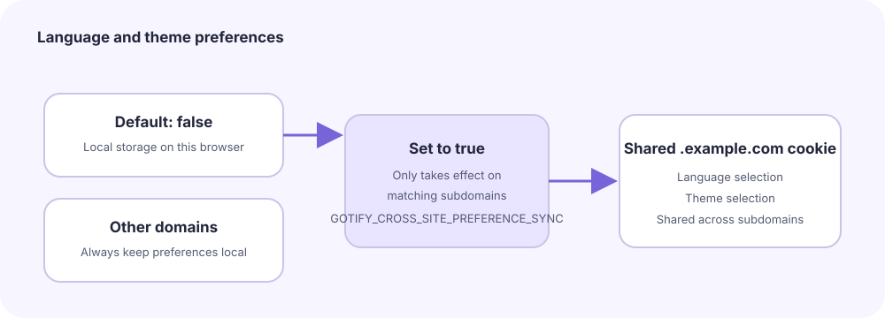

<p align="center">
  <a href="./README.md"><kbd>English</kbd></a>
  <a href="./README.zh-CN.md"><kbd>简体中文</kbd></a>
  <a href="./README.zh-TW.md"><kbd>繁體中文</kbd></a>
  <a href="./README.ja.md"><kbd>日本語</kbd></a>
  <a href="./README.fr.md"><kbd>Français</kbd></a>
</p>

<p align="center">
  
</p>

<p align="center">
  
</p>

<h1 align="center">Yume Gotify</h1>

<p align="center">Un service Gotify 3 multilingue et serverless, déployé sur Cloudflare Workers.</p>

## Présentation

Yume Gotify utilise Cloudflare Workers comme plateforme serverless, avec D1, R2 et Durable Objects pour les données, les images et les flux temps réel. Déployez le service sans gérer de serveurs tout en conservant une API compatible Gotify, une interface d’administration React et des réglages multilingues de langue et de thème.



### Fonctionnalités

- Gestion des applications, clients de réception, utilisateurs, messages et flux WebSocket
- Jetons d’application et de client Ed25519 de Gotify 3
- Connexion OIDC Web, PKCE natif, liaison de comptes et élévation de session
- Intégration de iGotify Notification Assistant et des aperçus SecNtfy
- D1 pour les données, R2 pour les images d’application et Durable Objects pour les flux temps réel
- Anglais, français, japonais, chinois simplifié et chinois traditionnel
- Thèmes automatique, clair et sombre
- Images et polices incluses dans le dépôt et servies directement par l’application
- Synchronisation facultative de la langue et du thème entre sous-domaines, désactivée par défaut

### Fonctions iGotify Notification Assistant

Le projet implémente l’API et le cycle de vie des appareils de iGotify Notification Assistant 1.6.0.0 :

- Découverte de version et du mode temps réel intégré : `GET /Version`, `/api/version`, `/realtime` et `/api/realtime`.
- Inscription et suppression d’appareils : `POST /device` et `DELETE /device` ; une nouvelle inscription actualise l’association du jeton SecNtfy et de sa clé publique.
- API des appareils : `POST /Device/CustomHeaders/{clientToken}`, `GET /Device/Test/{deviceToken}` et `POST /Notify/{clientToken}`.
- Les nouveaux messages Gotify sont transférés aux appareils iGotify inscrits du compte propriétaire. Le titre, le corps et l’URL de l’image des aperçus SecNtfy sont chiffrés avec la clé publique de chaque appareil. La priorité Gotify est conservée ; la priorité 10 déclenche une notification critique.
- Les échecs peuvent être repris par la tâche planifiée de rattrapage, avec une concurrence limitée pour éviter qu’un appareil lent ne bloque les autres.

La connexion OIDC native d’iGotify utilise les API PKCE de Gotify 3 ; voir la section de connexion.

## Déploiement

### Avec Cloudflare Workers Builds

1. Importez le dépôt dans Cloudflare **Workers & Pages**.
2. Laissez le répertoire racine vide. Utilisez `pnpm run build` comme commande de build et `pnpm run cloudflare:deploy` comme commande de déploiement.
3. Pour les branches hors production, utilisez `pnpm run cloudflare:preview`.
4. Ajoutez les secrets obligatoires `GOTIFY_DEFAULTUSER_PASS` et `GOTIFY_OIDC_CLIENTSECRET` dans **Variables & Secrets**, puis redéployez.
5. Vérifiez les liaisons D1, R2 et le domaine avant d’ouvrir le service aux utilisateurs.

Le dépôt suit le modèle `wrangler.example.jsonc`. Les scripts pnpm de développement, de build, de test et de déploiement le copient vers `wrangler.jsonc`, ignoré par Git, si la configuration locale est absente. Modifiez le modèle pour définir les valeurs de déploiement par défaut, ou la copie locale pour des réglages propres à la machine. Les identifiants de ressources sont omis afin que Wrangler crée les ressources au déploiement. Le Worker applique les migrations D1 avant de traiter les requêtes.

Avant de déployer un fork, modifiez `wrangler.example.jsonc` : adaptez `routes`, l’issuer OIDC, le client ID, l’URL de retour et l’origine CORS à votre compte Cloudflare, votre domaine et votre fournisseur d’identité. Les domaines de connexion Yume du dépôt ne conviennent qu’au déploiement Yume.

### Développement local

Node.js 22.22 ou ultérieur et pnpm sont requis.

```sh
pnpm install
cp examples/dev.vars.example .dev.vars
# Remplacez les valeurs d'exemple par des secrets locaux
pnpm dev
```

`.dev.vars` et le `wrangler.jsonc` généré localement sont ignorés par Git. Ne publiez pas de secrets réels et ne réutilisez pas ceux de production. Consultez [examples](./examples/) pour les autres modèles.

## Configuration

### Synchronisation de la langue et du thème

`GOTIFY_CROSS_SITE_PREFERENCE_SYNC` vaut `false` par défaut ; la langue et le thème restent alors dans le stockage local du navigateur. Pour activer le partage, passez la variable à `true` et définissez `GOTIFY_PREFERENCE_COOKIE_DOMAIN` sur un domaine parent que vous contrôlez, par exemple `.example.com`. L’application doit être hébergée sur ce domaine ou l’un de ses sous-domaines.



### Images

L’image d’arrière-plan et le Logo Bar sont dans `public/static/` et sont déployés avec le client Web. Les chemins par défaut sont :

- `/static/yume-background.jpg`
- `/static/yume-logo-bar.png`

Pour les remplacer, définissez `GOTIFY_BACKGROUND_IMAGE_URL` et `GOTIFY_LOGO_BAR_URL` dans les `vars` Wrangler. Les sources et sommes SHA-256 figurent dans [docs/ASSET_SOURCES.md](./docs/ASSET_SOURCES.md).

Les variables définies dans le tableau de bord Cloudflare sont conservées lors du déploiement. Pour une installation existante, remplacez aussi les URL de fond et de Logo Bar du tableau de bord par les chemins locaux.

### Connexion et CORS

- `GOTIFY_LOCALAUTH_ENABLED` active ou désactive la connexion par nom d’utilisateur et mot de passe.
- `GOTIFY_OIDC_ENABLED` active ou désactive OIDC. Enregistrez le rappel Web `https://<votre-domaine>/auth/oidc/callback` auprès du fournisseur.
- `CORS_ALLOW_ORIGIN` accepte une seule origine pour les navigateurs. Les clients CLI et natifs ne sont pas soumis à CORS.
- Enregistrez `GOTIFY_DEFAULTUSER_PASS` et `GOTIFY_OIDC_CLIENTSECRET` comme secrets Wrangler, jamais dans `vars` ou dans Git.

## Utilisation

1. Ouvrez le domaine déployé et connectez-vous selon la configuration de l’authentification locale et OIDC.
2. Dans **Applications**, créez une application. Le jeton `gtfya.` n’est renvoyé qu’une fois ; enregistrez-le immédiatement dans un gestionnaire de mots de passe ou un coffre de secrets.
3. Utilisez le [script d’envoi](./examples/send-message.sh) pour envoyer une notification. Le jeton passe dans l’en-tête `X-Gotify-Key`, jamais dans l’URL.
4. Dans **Clients**, créez un client de réception ou d’administration. Le jeton d’application sert à envoyer ; le jeton client sert à recevoir et administrer.
5. Vérifiez `/health` pour le service et D1, `/version` pour Gotify et `/Version` pour iGotify.
6. Consultez les journaux du Worker dans Cloudflare pour les erreurs et les notifications. Les images d’application sont stockées dans R2.

Si vous perdez un jeton d’application, régénérez-le dans l’interface d’administration et mettez à jour toutes les sources d’envoi.

## Exemples

- [Script d’envoi de notification](./examples/send-message.sh)
- [Corps JSON](./examples/message.json)
- [Modèle de secrets local](./examples/dev.vars.example)
- [Exemple de variables Wrangler](./examples/wrangler.vars.example.jsonc)

## Sécurité et licence

Ce logiciel est fourni en l’état. Il n’a pas fait l’objet d’un audit de sécurité indépendant ni d’une certification. Avant la production, examinez le code, protégez les secrets et limitez l’accès administrateur. Signalez les vulnérabilités via les avis de sécurité privés de GitHub ; ne publiez pas d’identifiants actifs dans les issues publiques.

Le code source du projet est sous licence MIT. Certaines parties de l’API et de l’interface proviennent de [gotify/server](https://github.com/gotify/server). MiSans et les autres éléments tiers restent soumis à leurs propres licences. Consultez [LICENSE](./LICENSE) et [THIRD_PARTY_NOTICES.md](./THIRD_PARTY_NOTICES.md).
