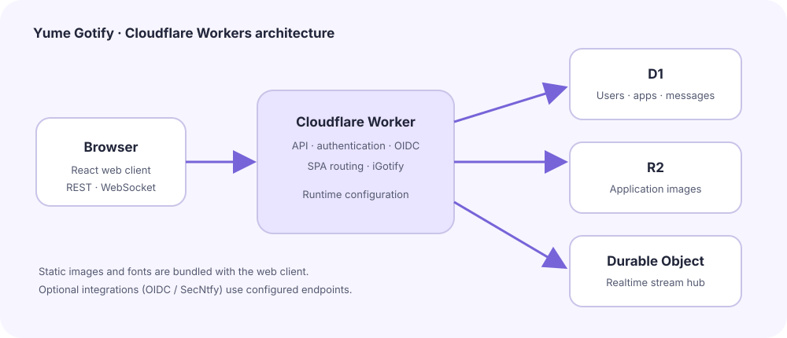
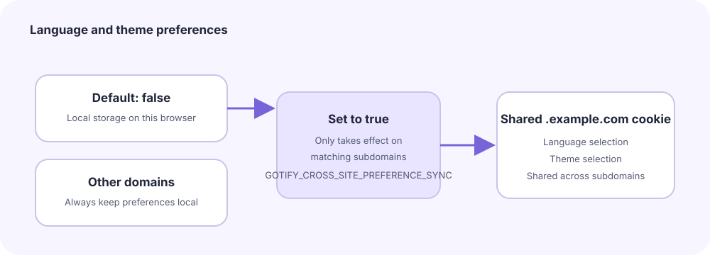

<p align="center">
  <a href="./README.md"><kbd>English</kbd></a>
  <a href="./README.zh-CN.md"><kbd>简体中文</kbd></a>
  <a href="./README.zh-TW.md"><kbd>繁體中文</kbd></a>
  <a href="./README.ja.md"><kbd>日本語</kbd></a>
  <a href="./README.fr.md"><kbd>Français</kbd></a>
</p>

<p align="center">
  
</p>

<p align="center">
  
</p>

<h1 align="center">Yume Gotify</h1>

<p align="center">Cloudflare Workers にデプロイするサーバーレス、多言語対応の Gotify 3 互換通知サービスです。</p>

## プロジェクト概要

Yume Gotify は Cloudflare Workers をサーバーレス実行基盤として利用し、D1、R2、Durable Objects でデータ、画像、リアルタイム配信を提供します。サーバーを自分で管理せずに、Gotify 互換 API、React 管理画面、多言語表示と言語・テーマ設定を運用できます。



### 主な機能

- アプリ、受信クライアント、ユーザー、メッセージ、WebSocket ストリームの管理
- Gotify 3 の Ed25519 アプリトークンとクライアントトークン
- OIDC ブラウザーログイン、ネイティブ PKCE、アカウント連携、セッション昇格
- iGotify Notification Assistant と SecNtfy プレビュー通知
- D1 によるデータ保存、R2 によるアプリ画像保存、Durable Object によるリアルタイム配信
- 英語、フランス語、日本語、簡体字中国語、繁体字中国語
- 自動、ライト、ダークのテーマ
- 画像とフォントは既定でリポジトリに同梱し、アプリ自身が配信します
- サブドメイン間の言語・テーマ同期は任意で、既定では無効

### iGotify Notification Assistant の対応機能

本プロジェクトは iGotify Notification Assistant 1.6.0.0 の API とデバイス管理を実装しています。

- バージョンと統合リアルタイム機能の確認：`GET /Version`、`/api/version`、`/realtime`、`/api/realtime`。
- デバイスの登録と削除：`POST /device`、`DELETE /device`。再登録時には SecNtfy のデバイストークンと公開鍵の関連付けを更新します。
- デバイス用 API：`POST /Device/CustomHeaders/{clientToken}`、`GET /Device/Test/{deviceToken}`、`POST /Notify/{clientToken}`。
- Gotify の新着メッセージを、同じユーザーに紐づく iGotify デバイスへ転送します。SecNtfy のプレビュー通知ではタイトル、本文、画像 URL を端末の公開鍵で暗号化します。優先度を保持し、優先度 10 は緊急通知として送信します。
- 失敗した配信はスケジュール済みの再処理対象となり、遅い端末がほかの端末を妨げないよう同時配信数を制限します。

iGotify のネイティブ OIDC ログインは Gotify 3 PKCE API を使います。ログイン設定を参照してください。

## デプロイ

### Cloudflare Workers Builds を使う

1. Cloudflare **Workers & Pages** にリポジトリをインポートします。
2. ルートディレクトリは空欄、ビルドコマンドは `pnpm run build`、デプロイコマンドは `pnpm run cloudflare:deploy` にします。
3. 非本番ブランチのプレビューコマンドには `pnpm run cloudflare:preview` を指定します。
4. **Variables & Secrets** に必須シークレット `GOTIFY_DEFAULTUSER_PASS` と `GOTIFY_OIDC_CLIENTSECRET` を登録してから再デプロイします。
5. D1、R2 のバインディングとドメインを確認してからサービスを公開します。

リポジトリで管理する設定は `wrangler.example.jsonc` テンプレートです。pnpm の開発、ビルド、テスト、デプロイスクリプトは、ローカル設定がない場合にテンプレートを Git 管理対象外の `wrangler.jsonc` にコピーします。デプロイの既定値はテンプレートに、マシン固有の値はローカルコピーに設定してください。テンプレートではリソース ID を省略しており、Wrangler がデプロイ時に必要なリソースを作成します。Worker はリクエスト処理前に D1 マイグレーションを適用します。

フォークをデプロイする場合は、先に `wrangler.example.jsonc` の `routes`、OIDC issuer、client ID、コールバック URL、CORS origin を自分の Cloudflare アカウント、ドメイン、ID プロバイダーに合わせて変更してください。リポジトリ内の Yume ログインドメインは Yume 環境専用です。

### ローカル開発

Node.js 22.22 以降と pnpm が必要です。

```sh
pnpm install
cp examples/dev.vars.example .dev.vars
# .dev.vars の値をローカル用の秘密情報に置き換える
pnpm dev
```

`.dev.vars` とローカルで生成される `wrangler.jsonc` は Git の追跡対象外です。実際の秘密情報をコミットしたり、本番用の値を使い回したりしないでください。その他の例は [examples](./examples/) を参照してください。

## 設定

### 言語とテーマの同期

`GOTIFY_CROSS_SITE_PREFERENCE_SYNC` の既定値は `false` で、言語とテーマは現在のブラウザーに保存されます。有効にする場合は `true` にし、`GOTIFY_PREFERENCE_COOKIE_DOMAIN` を管理している共通親ドメイン（例：`.example.com`）に変更してください。アプリはそのドメインまたはサブドメインで動作する必要があります。



### 画像アセット

背景画像とヘッダーの Logo Bar は `public/static/` に保存され、Web クライアントと一緒にデプロイされます。既定のパスは次のとおりです。

- `/static/yume-background.jpg`
- `/static/yume-logo-bar.png`

差し替える場合は Wrangler の `vars` で `GOTIFY_BACKGROUND_IMAGE_URL` と `GOTIFY_LOGO_BAR_URL` を設定します。元 URL と SHA-256 は [docs/ASSET_SOURCES.md](./docs/ASSET_SOURCES.md) に記載しています。

既存 Worker は Cloudflare Dashboard の変数をデプロイ後も保持します。更新時は、Dashboard 側の背景画像と Logo Bar の URL も同梱パスに変更してください。

### ログインと CORS

- `GOTIFY_LOCALAUTH_ENABLED` はユーザー名・パスワードログインを制御します。
- `GOTIFY_OIDC_ENABLED` は OIDC ログインを制御します。Web コールバック `https://<your-domain>/auth/oidc/callback` をプロバイダーに登録してください。
- `CORS_ALLOW_ORIGIN` はブラウザー用に許可する origin を 1 つ設定します。CLI とネイティブクライアントにはブラウザーの CORS 制約は適用されません。
- `GOTIFY_DEFAULTUSER_PASS` と `GOTIFY_OIDC_CLIENTSECRET` は Wrangler のシークレットとして保存し、`vars` や Git に置かないでください。

## 運用

1. デプロイしたドメインを開いてログインします。方式はローカル認証と OIDC の設定によって変わります。
2. **Applications** でアプリを作成します。作成時に `gtfya.` アプリトークンが一度だけ返されるため、すぐにパスワードマネージャーなどへ保存してください。
3. 外部送信元からは[送信例](./examples/send-message.sh)を使えます。アプリトークンは URL ではなく `X-Gotify-Key` ヘッダーで送信します。
4. **Clients** で通知受信用または管理用クライアントを作成します。アプリトークンは送信に、クライアントトークンは受信と管理に使います。
5. `/health` でサービスと D1 を確認し、`/version` で Gotify、`/Version` で iGotify のバージョンを確認します。
6. Cloudflare Worker のログでエラーと通知転送の記録を確認します。アプリ画像は R2 に保存されます。

アプリトークンは作成時または再生成時に一度だけ表示されます。紛失した場合は管理画面で再生成し、送信元の設定も更新してください。

## サンプル

- [通知送信スクリプト](./examples/send-message.sh)
- [メッセージ JSON](./examples/message.json)
- [ローカル用シークレット例](./examples/dev.vars.example)
- [Wrangler 変数例](./examples/wrangler.vars.example.jsonc)

## セキュリティとライセンス

本ソフトウェアは現状のまま提供され、独立したセキュリティ監査や認証は受けていません。本番利用前にコードを確認し、秘密情報を保護し、管理者アクセスを制限してください。脆弱性は GitHub の非公開セキュリティアドバイザリで報告してください。公開 Issue に有効な認証情報を含めないでください。

プロジェクトのソースコードは MIT ライセンスです。API と Web UI の一部は [gotify/server](https://github.com/gotify/server) に由来します。MiSans などの第三者素材には各自のライセンスが適用されます。[LICENSE](./LICENSE) と [THIRD_PARTY_NOTICES.md](./THIRD_PARTY_NOTICES.md) を参照してください。
