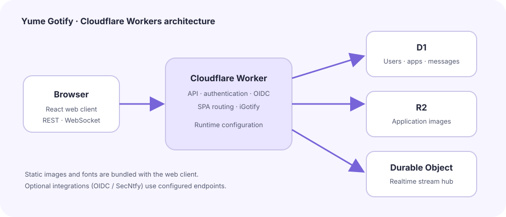
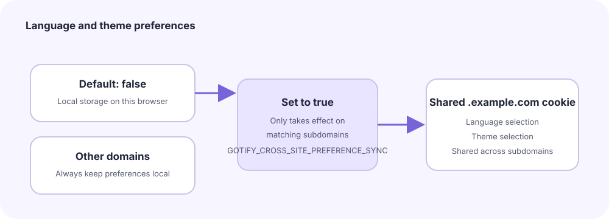

<p align="center">
  <a href="./README.md"><kbd>English</kbd></a>
  <a href="./README.zh-CN.md"><kbd>简体中文</kbd></a>
  <a href="./README.zh-TW.md"><kbd>繁體中文</kbd></a>
  <a href="./README.ja.md"><kbd>日本語</kbd></a>
  <a href="./README.fr.md"><kbd>Français</kbd></a>
</p>

<p align="center">
  
</p>

<p align="center">
  
</p>

<h1 align="center">Yume Gotify</h1>

<p align="center">基于 Cloudflare Workers 部署的无服务器、多语言 Gotify 3 兼容通知服务。</p>

## 项目介绍

Yume Gotify 以 Cloudflare Workers 为无服务器运行平台，使用 D1、R2 和 Durable Objects 分别保存数据与图片并提供实时流。无需自行管理服务器，即可使用 Gotify 兼容 API、响应式 React 管理界面和多语言主题设置。



### 功能

- 管理应用、接收客户端、用户、消息和 WebSocket 实时流
- 支持 Gotify 3 增强 Ed25519 应用令牌和客户端令牌
- 支持 OIDC 浏览器登录、原生 PKCE、账号关联和会话提升
- 集成 iGotify 通知助手与 SecNtfy 预览推送
- 使用 D1 保存数据、R2 保存应用图片、Durable Object 提供实时流
- 支持英语、法语、日语、简体中文和繁体中文
- 提供自动、浅色和深色主题
- 默认将界面图片和字体随项目部署，由本项目直接提供
- 可选的跨子域语言和主题同步，默认关闭

### iGotify 通知助手支持

项目实现 iGotify Notification Assistant 1.6.0.0 的 API 与设备流程：

- 版本和集成实时能力查询：`GET /Version`、`/api/version`、`/realtime`、`/api/realtime`。
- 设备注册与删除：`POST /device` 和 `DELETE /device`；重新注册会刷新 SecNtfy 设备令牌和公钥关联。
- 设备辅助接口：`POST /Device/CustomHeaders/{clientToken}`、`GET /Device/Test/{deviceToken}`、`POST /Notify/{clientToken}`。
- Gotify 新消息会转发给消息所属账户已注册的 iGotify 设备。SecNtfy 预览通知的标题、正文和图片地址使用设备公钥加密；保留 Gotify 优先级，并将优先级 10 标为紧急通知。
- 转发失败的消息可由定时补偿任务再次处理，并限制并发，避免慢设备阻塞其他设备。

iGotify 原生 OIDC 登录使用 Gotify 3 PKCE 接口，详见登录配置部分。

## 部署

### 使用 Cloudflare Workers Builds

1. 将仓库导入 Cloudflare **Workers & Pages**。
2. 设置根目录为空，构建命令为 `pnpm run build`，部署命令为 `pnpm run cloudflare:deploy`。
3. 非生产分支预览命令使用 `pnpm run cloudflare:preview`。
4. 在 **Variables & Secrets** 中添加必需密钥 `GOTIFY_DEFAULTUSER_PASS` 和 `GOTIFY_OIDC_CLIENTSECRET`，然后重新部署。
5. 检查 D1、R2 绑定和部署域名后再开放服务。

仓库跟踪的是 `wrangler.example.jsonc` 模板。pnpm 的开发、构建、测试和部署脚本会在缺少本地配置时自动复制它为被 Git 忽略的 `wrangler.jsonc`。请在模板中设置部署默认值，或在本地副本中设置机器专属配置。模板省略资源 ID，Wrangler 会在部署时创建所需资源。Worker 在处理请求前自动应用 D1 迁移。

克隆后请先编辑 `wrangler.example.jsonc`：更改 `routes`、OIDC issuer、client ID、回调 URL 和 CORS 来源，使其符合你自己的 Cloudflare 账户、域名和身份提供商。仓库中的 Yume 登录域名只适用于 Yume 部署。

### 本地开发

需要 Node.js 22.22 或更高版本及 pnpm：

```sh
pnpm install
cp examples/dev.vars.example .dev.vars
# 编辑 .dev.vars，将示例值替换为本地开发密钥
pnpm dev
```

`.dev.vars` 和本地生成的 `wrangler.jsonc` 已被 Git 忽略。不要提交真实密钥或复用生产凭证。更多变量示例见 [examples](./examples/)。

## 配置

### 语言与主题同步

`GOTIFY_CROSS_SITE_PREFERENCE_SYNC` 默认是 `false`，语言和主题只保存在当前浏览器。启用时将它设为 `true`，并把 `GOTIFY_PREFERENCE_COOKIE_DOMAIN` 改成你控制的共同父域，例如 `.example.com`。应用必须部署在该域名或其子域下。



### 图片资源

背景图和顶部 Logo Bar 已保存在 `public/static/` 并随客户端部署。默认路径为：

- `/static/yume-background.jpg`
- `/static/yume-logo-bar.png`

如需更换，可在 Wrangler 的 `vars` 中设置 `GOTIFY_BACKGROUND_IMAGE_URL` 和 `GOTIFY_LOGO_BAR_URL`。资产来源和 SHA-256 校验值见 [docs/ASSET_SOURCES.md](./docs/ASSET_SOURCES.md)。

现有 Worker 会保留 Cloudflare Dashboard 中设置的变量；升级时也要将其中的背景图和 Logo Bar 地址改成本地路径。

### 登录与跨域

- `GOTIFY_LOCALAUTH_ENABLED` 控制用户名和密码登录。
- `GOTIFY_OIDC_ENABLED` 控制 OIDC 登录；请为 Web 回调注册 `https://<你的域名>/auth/oidc/callback`。
- `CORS_ALLOW_ORIGIN` 可设置一个允许的浏览器来源。命令行和原生客户端不受浏览器 CORS 限制。
- `GOTIFY_DEFAULTUSER_PASS` 和 `GOTIFY_OIDC_CLIENTSECRET` 必须作为 Wrangler 密钥保存，不能放进 `vars` 或 Git。

## 日常操作

1. 打开部署域名并登录。登录方式取决于本地认证和 OIDC 配置。
2. 在 **Applications** 中创建应用。创建响应会显示一次 `gtfya.` 应用令牌；请立即保存到密码管理器或密钥存储中。
3. 外部发送端可使用 [发送消息示例](./examples/send-message.sh)。它通过 `X-Gotify-Key` 请求头传递应用令牌，避免把令牌放入 URL。
4. 在 **Clients** 中创建接收消息或管理客户端。应用令牌用于发送，客户端令牌用于接收和管理。
5. 使用 `/health` 检查服务与 D1，使用 `/version` 查看 Gotify 版本，使用 `/Version` 查看 iGotify 版本。
6. 在 Cloudflare Worker 日志中查看运行错误和通知转发记录。应用图片保存在 R2。

应用令牌只在创建或重新生成时返回一次；丢失后请在管理界面重新生成，并更新所有发送端。

## 示例

- [发送通知脚本](./examples/send-message.sh)
- [消息 JSON](./examples/message.json)
- [本地密钥模板](./examples/dev.vars.example)
- [Wrangler 变量片段](./examples/wrangler.vars.example.jsonc)

## 安全与许可

本项目按“现状”提供，尚未经过独立安全审计或认证。部署者应在生产环境使用前审查代码、保护密钥并限制管理员访问。漏洞请通过 GitHub 私密安全公告渠道报告，不要在公开 Issue 中提交有效凭证。

项目源代码采用 MIT 许可证。部分 API 和界面代码源自 [gotify/server](https://github.com/gotify/server)；MiSans 等第三方材料保留各自许可。详见 [LICENSE](./LICENSE) 和 [THIRD_PARTY_NOTICES.md](./THIRD_PARTY_NOTICES.md)。
