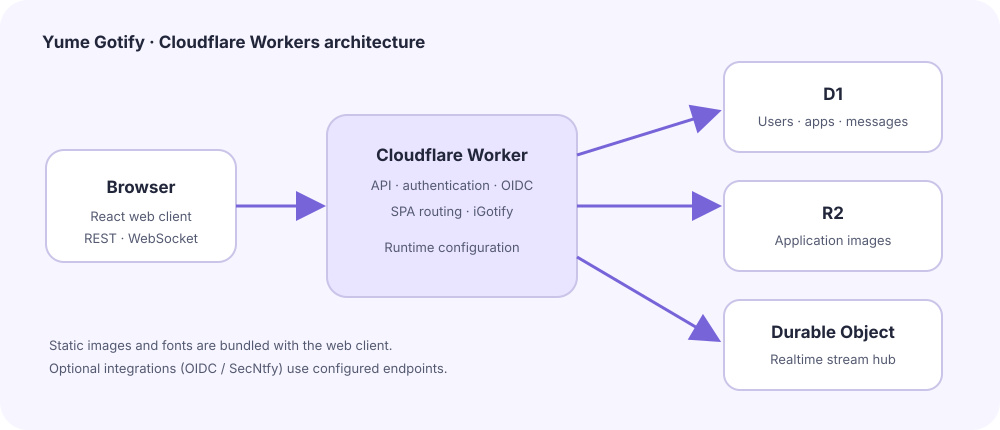
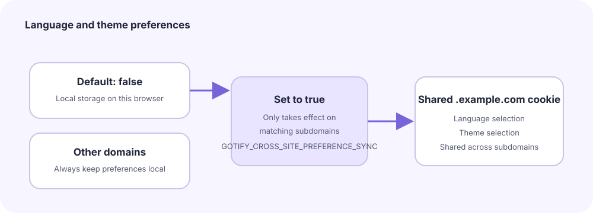

<p align="center">
  <a href="./README.md"><kbd>English</kbd></a>
  <a href="./README.zh-CN.md"><kbd>简体中文</kbd></a>
  <a href="./README.zh-TW.md"><kbd>繁體中文</kbd></a>
  <a href="./README.ja.md"><kbd>日本語</kbd></a>
  <a href="./README.fr.md"><kbd>Français</kbd></a>
</p>

<p align="center">
  
</p>

<p align="center">
  
</p>

<h1 align="center">Yume Gotify</h1>

<p align="center">以 Cloudflare Workers 部署的無伺服器、多語言 Gotify 3 相容通知服務。</p>

## 專案介紹

Yume Gotify 以 Cloudflare Workers 作為無伺服器執行平台，並使用 D1、R2 和 Durable Objects 儲存資料與圖片及提供即時串流。無需自行管理伺服器，即可使用 Gotify 相容 API、響應式 React 管理介面和多語言主題設定。



### 功能

- 管理應用程式、接收用戶端、使用者、訊息與 WebSocket 即時串流
- 支援 Gotify 3 增強型 Ed25519 應用程式權杖和用戶端權杖
- 支援 OIDC 瀏覽器登入、原生 PKCE、帳號連結與工作階段提升
- 整合 iGotify 通知助理與 SecNtfy 預覽推播
- 使用 D1 儲存資料、R2 儲存應用程式圖片、Durable Object 提供即時串流
- 支援英文、法文、日文、簡體中文與繁體中文
- 提供自動、淺色與深色主題
- 介面圖片和字型預設隨專案部署，由本專案直接提供
- 可選的跨子網域語言與主題同步，預設關閉

### iGotify 通知助理支援

本專案實作 iGotify Notification Assistant 1.6.0.0 的 API 與裝置流程：

- 版本與整合即時能力查詢：`GET /Version`、`/api/version`、`/realtime`、`/api/realtime`。
- 裝置註冊與刪除：`POST /device` 和 `DELETE /device`；重新註冊會更新 SecNtfy 裝置權杖與公開金鑰關聯。
- 裝置輔助介面：`POST /Device/CustomHeaders/{clientToken}`、`GET /Device/Test/{deviceToken}`、`POST /Notify/{clientToken}`。
- Gotify 新訊息會轉送給訊息所屬帳戶已註冊的 iGotify 裝置。SecNtfy 預覽通知的標題、內文和圖片網址會以裝置公開金鑰加密；保留 Gotify 優先級，優先級 10 會標示為緊急通知。
- 轉送失敗的訊息可由排程補償工作再次處理，並限制並行數，避免慢速裝置阻塞其他裝置。

iGotify 原生 OIDC 登入使用 Gotify 3 PKCE 介面，詳見登入設定。

## 部署

### 使用 Cloudflare Workers Builds

1. 將儲存庫匯入 Cloudflare **Workers & Pages**。
2. 根目錄留空；建置命令設為 `pnpm run build`，部署命令設為 `pnpm run cloudflare:deploy`。
3. 非正式環境分支預覽命令使用 `pnpm run cloudflare:preview`。
4. 在 **Variables & Secrets** 新增必要密鑰 `GOTIFY_DEFAULTUSER_PASS` 和 `GOTIFY_OIDC_CLIENTSECRET`，然後重新部署。
5. 確認 D1、R2 綁定和部署網域後，再對使用者開放服務。

儲存庫追蹤的是 `wrangler.example.jsonc` 範本。pnpm 的開發、建置、測試和部署指令會在本機設定不存在時自動複製為 Git 忽略的 `wrangler.jsonc`。請在範本中設定部署預設值，或在本機副本設定機器專屬值。範本省略資源 ID，Wrangler 會在部署時建立所需資源。Worker 會在處理請求前自動套用 D1 遷移。

複製後請先編輯 `wrangler.example.jsonc`：修改 `routes`、OIDC issuer、client ID、回呼 URL 和 CORS 來源，使其符合自己的 Cloudflare 帳戶、網域和身分提供者。儲存庫中的 Yume 登入網域只適用於 Yume 部署。

### 本機開發

需要 Node.js 22.22 或更新版本及 pnpm：

```sh
pnpm install
cp examples/dev.vars.example .dev.vars
# 編輯 .dev.vars，將範例值換成本機開發密鑰
pnpm dev
```

`.dev.vars` 和本機產生的 `wrangler.jsonc` 已加入 Git 忽略清單。請勿提交真實密鑰，也不要重複使用正式環境憑證。其他變數範例請參閱 [examples](./examples/)。

## 設定

### 語言與主題同步

`GOTIFY_CROSS_SITE_PREFERENCE_SYNC` 預設為 `false`，語言與主題只會儲存在目前瀏覽器。啟用時將它設為 `true`，並把 `GOTIFY_PREFERENCE_COOKIE_DOMAIN` 改成你管理的共用父網域，例如 `.example.com`。應用程式必須部署於該網域或其子網域。



### 圖片資源

背景圖片和頂部 Logo Bar 已儲存在 `public/static/`，並隨用戶端部署。預設路徑如下：

- `/static/yume-background.jpg`
- `/static/yume-logo-bar.png`

如需替換，可在 Wrangler 的 `vars` 設定 `GOTIFY_BACKGROUND_IMAGE_URL` 和 `GOTIFY_LOGO_BAR_URL`。來源及 SHA-256 校驗值請見 [docs/ASSET_SOURCES.md](./docs/ASSET_SOURCES.md)。

既有 Worker 會保留 Cloudflare Dashboard 中設定的變數；升級時也請將背景圖片和 Logo Bar 位址改為本機路徑。

### 登入與跨來源

- `GOTIFY_LOCALAUTH_ENABLED` 控制帳號密碼登入。
- `GOTIFY_OIDC_ENABLED` 控制 OIDC 登入；請為 Web 回呼註冊 `https://<你的網域>/auth/oidc/callback`。
- `CORS_ALLOW_ORIGIN` 可設定一個允許的瀏覽器來源。命令列和原生用戶端不受瀏覽器 CORS 限制。
- `GOTIFY_DEFAULTUSER_PASS` 和 `GOTIFY_OIDC_CLIENTSECRET` 必須以 Wrangler 密鑰保存，不可放入 `vars` 或 Git。

## 日常操作

1. 開啟部署網域並登入。登入方式取決於本機驗證和 OIDC 設定。
2. 在 **Applications** 建立應用程式。建立回應會顯示一次 `gtfya.` 應用程式權杖；請立即存入密碼管理器或密鑰儲存空間。
3. 外部傳送端可使用[傳送訊息範例](./examples/send-message.sh)。它透過 `X-Gotify-Key` 標頭傳遞應用程式權杖，避免將權杖放入 URL。
4. 在 **Clients** 建立接收訊息或管理用戶端。應用程式權杖用於傳送，用戶端權杖用於接收和管理。
5. 使用 `/health` 檢查服務與 D1，使用 `/version` 查看 Gotify 版本，使用 `/Version` 查看 iGotify 版本。
6. 在 Cloudflare Worker 日誌中查看執行錯誤和通知轉送記錄。應用程式圖片儲存在 R2。

應用程式權杖只會在建立或重新產生時回傳一次；若遺失，請在管理介面重新產生，並更新所有傳送端。

## 範例

- [傳送通知指令碼](./examples/send-message.sh)
- [訊息 JSON](./examples/message.json)
- [本機密鑰範本](./examples/dev.vars.example)
- [Wrangler 變數片段](./examples/wrangler.vars.example.jsonc)

## 安全與授權

本專案依「現況」提供，尚未經過獨立安全稽核或認證。部署者應在正式環境使用前審查程式碼、保護密鑰並限制管理員存取。漏洞請透過 GitHub 私密安全公告回報，請勿在公開 Issue 提交有效憑證。

專案原始碼採用 MIT 授權。部分 API 和介面程式碼源自 [gotify/server](https://github.com/gotify/server)；MiSans 等第三方材料保留各自授權。詳見 [LICENSE](./LICENSE) 與 [THIRD_PARTY_NOTICES.md](./THIRD_PARTY_NOTICES.md)。
